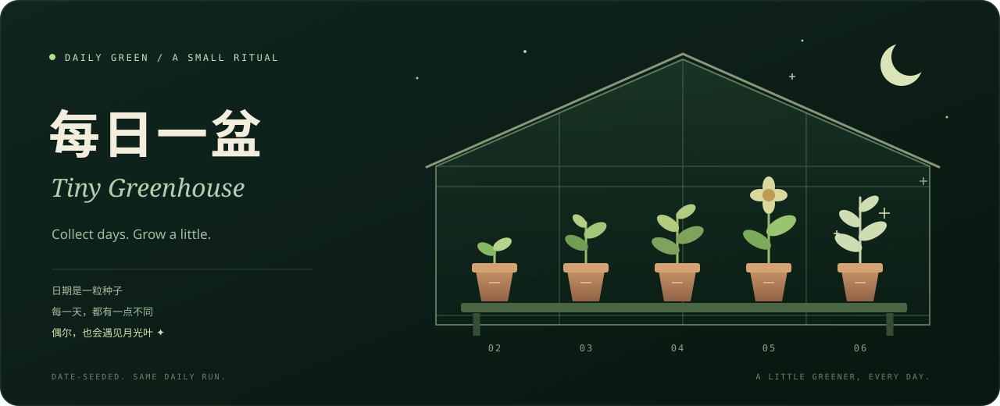

# Daily Green · 每日一盆

把每天一点绿意，养成一座可以逛的小温室。

Daily Green 是一份可自行部署的通用模板，内含 Tiny Greenhouse 小温室：在专用仓库里生成每天 2–6 次装饰性提交，可选自动一致性 review；同时附带一座离线可玩的温室，能直接放进自己的网站。模板不包含任何人的真实配置、活动历史或收藏数据。

## 从这里开始

| 你想做什么 | 入口 |
| --- | --- |
| 让 Agent 帮你配置专用私有仓库 | [复制启动提示词](docs/AGENT_START.md) |
| 自己按步骤配置 | [配置与运行指南](docs/SETUP.md) |
| 只玩温室，或放进自己的网站 | [温室与网站嵌入](docs/EMBED.md) |
| 了解数据保存与凭据边界 | [隐私说明](PRIVACY.md) |

把这段话交给已能使用终端和 GitHub CLI 的 Agent：

> 请阅读这个项目的 AGENTS.md 和 docs/AGENT_START.md，为我创建一个专用私有实例，从今天开始配置每日提交。先用 dry-run 核对目标仓库，再应用配置；不要改动其他项目，不要启动额外的检查工作流。需要 review token 时，请引导我自行在 GitHub 创建并保存为 Secret，不要向我要 token，也不要上传现有 CLI 凭据。完成后给我运行说明和温室页面入口。

公开模板默认不运行自动化。实例启用后每天只有一个实际任务，没有推送检查、晚间巡检或测试任务。Token 的创建与保存需要本人完成，因此“一条提示词”指由 Agent 完成可自动化的配置步骤，不会跳过账号授权。

## 每天会发生什么

1. 在实例仓库里更新当天的小记录，按日期固定生成 2–6 次提交；重复运行不会重复补同一天。
2. 可选：bot 为当天的一致性快照创建 PR，本人的受限 token 提交 `COMMENTED` review，bot 合并并清理分支。
3. 正常任务的 Summary 展示当天植物卡。温室页面按日期在浏览器生成，不需要每日重新构建或部署。

这些提交是自动生成的装饰记录；review 会明确标注为自动一致性检查，不能代表人工代码审核或真实工作量。GitHub 贡献是否计入、何时显示，以 GitHub 自身规则为准；不保证贡献比例或统计结果。

## 温室里有什么

六种植物、偶尔出现的月光叶、四种日历天气，以及会送便笺的蜗牛、飞蛾、瓢虫与小猫。可以浇水、收藏日期、收集访客印章，或等到天黑看看晚灯和萤火虫。

直接下载并用浏览器打开 `garden/index.html`，无需登录、安装依赖或启动服务器。天气是日历彩蛋，不是真实预报。页面也可以作为独立静态文件复制到自己网站的 `public/garden/index.html`；详见[嵌入指南](docs/EMBED.md)。

## 本地开发

修改 `garden/` 下的三个 JavaScript 源脚本后，重新内联到单文件页面：

```sh
python3 -B scripts/build_greenhouse.py
```

测试都在本地运行，不需要 token、外部 API 或云端工作流：

```sh
python3 -B -m unittest discover -s tests -v
node tests/test_garden_core.js
node tests/test_visitor_art.js
node tests/test_garden_ui.js
```

Python 脚本使用标准库，前端测试使用 Node.js 内置模块。控制器测试采用简化 DOM 模型，不代替真实浏览器的布局和可访问性检查。

## 许可与费用

代码与仓库内 SVG 采用 [MIT License](LICENSE)。运行不调用付费 AI，也不要求额外托管服务；GitHub Actions 的可用额度和费用取决于实例的可见性、账号套餐及实际运行情况。温室日常游玩不启动 Actions。
