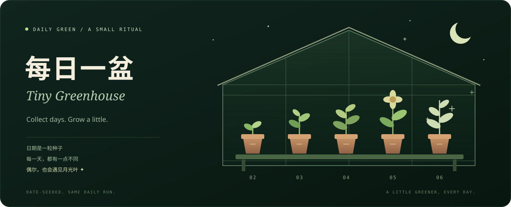

# Daily Green · 每日一盆

翻一翻日历，看看今天长出了什么。

[在线体验小温室](https://iqwqi.win/garden/)

Daily Green 是一个 GitHub 仓库模板。你可以用它在自己的私有仓库里每天生成几次装饰性提交，也可以挑过去的日期做一份单独的归档。模板里的小温室叫 Tiny Greenhouse，打开浏览器就能玩，也能放到自己的网站上。

## 从这里开始

| 你想做什么 | 入口 |
| --- | --- |
| 让 Agent 配置每日提交 | [复制启动提示词](docs/AGENT_START.md) |
| 自己配置和管理每日提交 | [配置与运行指南](docs/SETUP.md) |
| 只给选中的历史日期生成提交 | [按年份归档](docs/SETUP.md#按年份归档) |
| 离线逛温室，或把它放到自己的网站 | [温室与网站嵌入](docs/EMBED.md) |
| 查看记录存在哪里、哪些人能看到 | [隐私说明](PRIVACY.md) |

如果已经有能用终端和 GitHub CLI 的 Agent，可以把这段话交给它。

> 请读一下这个项目的 AGENTS.md 和 docs/AGENT_START.md，帮我创建一个专用私有实例，从今天开始配置每日提交。先预览，核对仓库后再应用。只操作这个新仓库，别启动额外的检查工作流。如果我选择自动 review，请引导我在 GitHub 自己创建 token 并保存为 Secret。请通过 GitHub CLI 正常认证，别向我要 token，也别读取或上传现有的 CLI token。完成后告诉我什么时候运行、怎么暂停，以及从哪里打开温室。

Agent 可以完成仓库配置，账号登录和可选 review 的 Secret 由你自己处理。公开模板默认不开启自动化。

## 每天会发生什么

私有实例启用后，GitHub Actions 每天运行一个任务，按日期生成 2–6 次装饰性提交。当天已完成的部分会跳过。任务的运行摘要里可以看到当天的植物卡。

如果配置了可选 review，机器人会为当天的快照开一个 PR。你的受限 token 会提交一条标明自动生成的 `COMMENTED` review，随后机器人合并 PR 并清理分支。这些提交和 review 是装饰记录，GitHub 会按自己的规则决定是否计入贡献以及何时显示。

## 温室里有什么

日历里有六种植物、四种天气，还有偶尔出现的月光叶。给植物浇水、把喜欢的日期收进收藏，或和路过的蜗牛、飞蛾、瓢虫和小猫打个招呼。访客会留下便笺和各自的印章，天黑后还能看到晚灯和萤火虫。

每天有三条寻宝线索。翻到对应植物、天气或访客出现的那一天，就能找到线索的答案。寻宝进度留在当前页面，天气则是根据日期生成的小彩蛋。

下载 `garden/index.html`，用浏览器直接打开即可。植物和访客在浏览器里生成，平时逛温室不占用 Actions 时间。想把页面放到自己的网站，可以按[嵌入指南](docs/EMBED.md)复制这个文件。

## 本地开发

修改 `garden/` 下的三个 JavaScript 源脚本后，用下面的命令更新单文件页面。

```sh
python3 -B scripts/build_greenhouse.py
```

下面的测试直接在本地运行，无需 token、外部 API 或云端工作流。

```sh
python3 -B -m unittest discover -s tests -v
node tests/test_garden_core.js
node tests/test_visitor_art.js
node tests/test_garden_ui.js
```

Python 脚本使用标准库，前端测试使用 Node.js 内置模块。控制器测试用简化的 DOM 检查交互逻辑，页面布局和可访问性需要在实际浏览器里检查。

## 许可与费用

代码和仓库里的 SVG 使用 [MIT License](LICENSE)。项目运行时无需付费 AI 或额外托管服务。GitHub Actions 的额度和费用取决于仓库可见性、账号套餐和实际用量。
